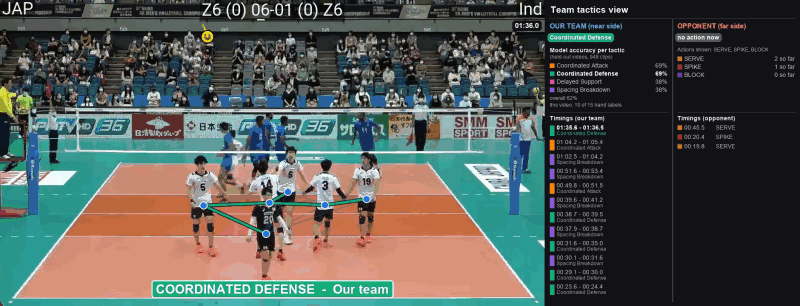
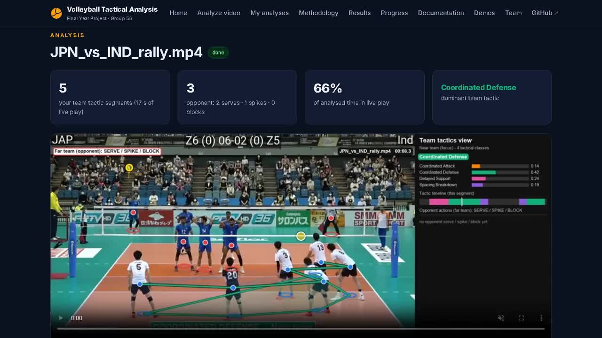
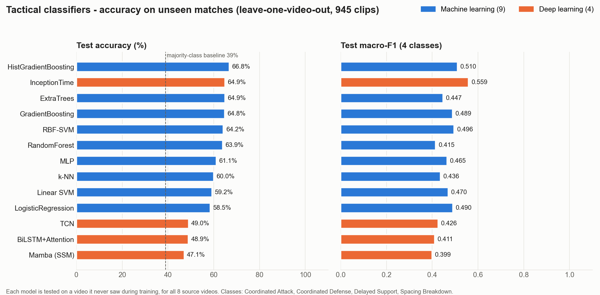
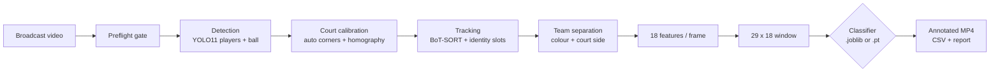
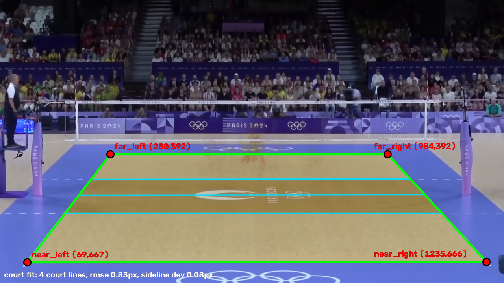
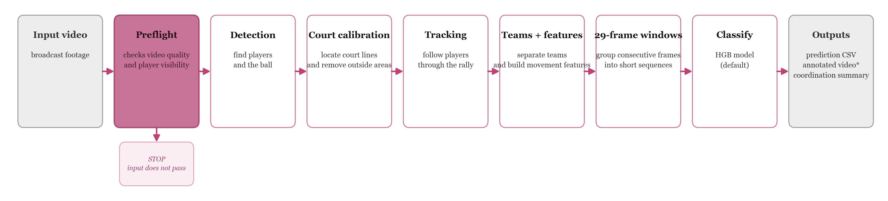

<div align="center">

# 🏐 Volleyball Tactical Intelligence

**Automated team-tactic analysis from a single broadcast camera**

Detect and track every player and the ball, map them onto the court, and label each second of play with the team's collective tactic.

[](https://github.com/Yeshwanthreddy7/volleyball-tactical-intelligence-fyp/actions/workflows/tests.yml)
[](LICENSE)
[](https://www.python.org/)
[](https://pytorch.org/)
[](https://docs.ultralytics.com/)
[](webapp/)
[](https://volleyballanalyzer.dpdns.org)

[**Live demo**](https://volleyballanalyzer.dpdns.org) ·
[**Installation**](docs/INSTALLATION.md) ·
[**Usage**](docs/USAGE.md) ·
[**Architecture**](docs/ARCHITECTURE.md) ·
[**Full report**](docs/PROJECT_DOCUMENTATION.md) ·
[**Changelog**](CHANGELOG.md) ·
[**🎥 UI walkthrough video**](#demo-videos)



<sub>Output on an unseen match: near-team formation graph, tactic banner, per-class accuracy and the opponent SERVE / SPIKE / BLOCK timeline.</sub>

</div>

---

## Table of contents

- [Demo videos](#demo-videos)
- [Overview](#overview)
- [Key features](#key-features)
- [Results](#results)
- [How it works](#how-it-works)
- [Quick start](#quick-start)
- [Web application](#web-application)
- [Project structure](#project-structure)
- [Documentation](#documentation)
- [Testing and reproducibility](#testing-and-reproducibility)
- [Limitations and future work](#limitations-and-future-work)
- [Team](#team)
- [Citation](#citation) · [License](#license) · [References](#references)

---

## Demo videos

### Website walkthrough (screen recording of the UI in use)

[](docs/assets/ui_walkthrough.mp4)

**▶ [Watch the walkthrough (MP4, 3 min 17 s)](docs/assets/ui_walkthrough.mp4)** · also on the website's [Demos page](https://volleyballanalyzer.dpdns.org/demos) and attached to the [v1.0.0 release](https://github.com/Yeshwanthreddy7/volleyball-tactical-intelligence-fyp/releases/tag/v1.0.0)

| Time | What the recording shows |
|---|---|
| 0:00 | Home page: project summary, problem statement, objectives |
| 0:20 | **Analyze video**: choose a 25-second match clip, preview it, pick *Accurate · 1280 px*, upload |
| 0:35 | **Live progress**: court calibration → player and ball detection → tactics → rendering → reports (the ~4 min GPU wait is shortened) |
| 1:15 | **Results**: annotated video with the near-team formation graph and tactic panel, summary cards, tactic timeline |
| 1:45 | Team tactical report, opponent action report, tactic segments, opponent actions, court calibration |
| 2:15 | My analyses, Demos, Methodology, Results, Documentation and Team pages |

The recording was made on the project laptop (RTX 3050 GPU) at `http://volleyballtactics.localhost`; the same interface runs at [volleyballanalyzer.dpdns.org](https://volleyballanalyzer.dpdns.org).

---

## Overview

Coaches need fast, objective feedback on how a team coordinates. Manual video notation is slow and subjective, and most sports-analytics tools describe single actions or the ball path, not the *collective* behaviour of six players.

This project turns raw broadcast video into a second-by-second tactical reading of a team. Every 1-second window of live play is labelled as one of four tactics:

| Class | What it means |
|---|---|
| 🟧 **Coordinated Attack** | Front-court attackers approach fast while base players hold near the net |
| 🟩 **Coordinated Defense** | The team shifts as one rigid unit |
| 🟪 **Delayed Support** | The nearest player reacts late after ball contact |
| 🟦 **Spacing Breakdown** | The formation is too spread out or too clustered |

Dead-ball and out-of-play windows are marked **Transition**. The opponent's **SERVE**, **SPIKE** and **BLOCK** actions are time-stamped separately.

**Why it is hard.** The ball is only 15–20 px wide in 720p video. At the net both teams stand within a metre of each other. Broadcast video cuts to replays and close-ups. Tracker IDs swap during occlusions. And there is one uncalibrated camera, different in every match.

---

## Key features

- **End-to-end pipeline** — video in; annotated MP4, per-window CSV and coordination report out.
- **Dual detector** — stock YOLO11 for players, a fine-tuned YOLO for the ball, both at 1280 px.
- **Automatic court calibration** — court corners found from the painted lines of an empty-court base frame; homography and camera-motion compensation.
- **Robust team separation** — jersey-colour clustering, each cluster assigned to a team by its median court side.
- **Permutation-invariant features** — 18 scale-invariant channels per frame, so the descriptor does not depend on player order or camera scale.
- **25+ trained models** — 12 scikit-learn models (HGB, XGBoost, LightGBM, CatBoost, SVMs, forests, …) and 4 deep sequence models (InceptionTime, TCN, BiLSTM + Attention, Mamba SSM) behind one interface.
- **Honest evaluation** — every headline number is leave-one-video-out (LOVO): the test match is never seen in training.
- **Provenance guard** — each model stores the extraction flags it was trained with; a mismatch at inference stops the run instead of producing confident wrong labels.
- **Full-stack web app** — FastAPI + React + MongoDB, with upload, job queue, multi-quality video, reports, per-tactic clips, desktop app, Windows installer and cloud deployment.
- **Reproducible** — `python reproduce.py` regenerates the metrics and fails if any reported property does not hold; 257 unit tests run in CI.

---

## Results

**Dataset:** 948 human-labelled 1-second clips from 8 international matches. **Protocol:** leave-one-video-out. **Majority-class baseline:** 39.0% accuracy.

### 4-class tactic classifier

| Model | Type | Accuracy | Macro-F1 | Cohen κ |
|---|---|:---:|:---:|:---:|
| **HistGradientBoosting** (deployed) | ML | **67.0%** | 0.510 | 0.498 |
| LightGBM | ML | 67.0% | 0.507 | 0.500 |
| XGBoost | ML | 66.7% | 0.519 | 0.498 |
| CatBoost | ML | 64.7% | **0.520** | 0.478 |
| RBF-SVM | ML | 64.6% | 0.500 | 0.466 |
| InceptionTime | DL | 61.9% | 0.515 | – |
| TCN | DL | 51.2% | 0.441 | – |
| Mamba SSM | DL | 46.1% | 0.390 | – |
| BiLSTM + Attention | DL | 45.9% | 0.398 | – |
| *Majority class* | baseline | 39.0% | 0.140 | 0.000 |
| *Hand-coded rule engine* | baseline | 10.1% | 0.090 | 0.005 |

HistGradientBoosting was chosen as the deployed model **before** the results were seen, not picked as the best of many runs. The deep models are comparison arms.

| Class | Clips | LOVO accuracy |
|---|:---:|:---:|
| Coordinated Attack | 370 | 69% |
| Coordinated Defense | 355 | 69% |
| Delayed Support | 108 | 38% |
| Spacing Breakdown | 115 | 38% |

### 2-class Attack / Defense classifier

Reducing the task to the two well-defined classes (723 clips, majority baseline 51%):

| Model | Accuracy | Macro-F1 | ROC-AUC |
|---|:---:|:---:|:---:|
| **InceptionTime** | **89.5%** | 0.895 | 0.957 |
| TCN | 88.0% | 0.879 | 0.950 |
| BiLSTM + Attention | 87.8% | 0.878 | 0.942 |
| Mamba SSM | 84.8% | 0.847 | 0.924 |
| Best ML (RBF-SVM) | 83.7% | 0.837 | 0.921 |

A weighted InceptionTime + BiLSTM + TCN ensemble reaches **0.906 LOVO macro-F1** and annotated a full unseen 45-minute match with HMM smoothing (`v7_tactical/`).

<p align="center">
  
</p>

Full tables: [FINALE_OUTPUTS](FINALE_OUTPUTS/README.md) · [BINARY_ATTACK_DEFENSE](BINARY_ATTACK_DEFENSE/README.md) · `ml_results_v6/` · `deep_results_v6/`.

---

## How it works



| Stage | Module | Key idea |
|---|---|---|
| Preflight | `fyp/preflight.py` | Abort on unusable input instead of producing a wrong answer |
| Detection | `fyp/interfaces.py` | Stock YOLO11 finds 14–23 players/frame; the ball fine-tune lifts ball recall from 16% to 67% |
| Court | `fyp/court.py`, `BASEFRAMES/` | Verified court-model fit on painted lines (0.5–2.4 px RMSE on all 11 videos) |
| Tracking | `fyp/tracking.py`, `fyp/identity.py` | BoT-SORT + persistent slots that survive occlusion |
| Teams | `fyp/teams.py` | k = 4 colour clusters (each team has a libero), labelled by median court side: 10.7 → 5.8 players/frame |
| Features | `fyp/features.py` | Centroid, spread, hull, spacing, speeds, synchrony, ball — scale- and permutation-invariant |
| Classifier | `fyp/ml_classifier.py`, `fyp/mamba_model.py` | Same `(29, 18)` contract for every model, chosen by file extension |

<p align="center">
  
  
</p>

More detail: [docs/ARCHITECTURE.md](docs/ARCHITECTURE.md) (modules, data contracts, API) and [docs/METHODOLOGY.md](docs/METHODOLOGY.md) (formal method).

---

## Quick start

> Full instructions, GPU setup and troubleshooting: **[docs/INSTALLATION.md](docs/INSTALLATION.md)**

**1. Install**

```bash
git clone https://github.com/Yeshwanthreddy7/volleyball-tactical-intelligence-fyp.git
cd volleyball-tactical-intelligence-fyp
python -m venv .venv
source .venv/bin/activate          # Windows: .venv\Scripts\activate
pip install -r requirements.txt
```

**2. Check the install** (no GPU or video needed)

```bash
python -m pytest fyp/tests -q      # expected: 257 passed
```

**3. Analyse a match**

```bash
python fyp/pipeline.py "match.mp4" tactical_ml_v6.joblib \
  --yolo-model yolo11n.pt --ball-model fyp/volleyball_best.pt --imgsz 1280 \
  --team-split colour --tracker botsort --auto-court --court-coords linear \
  --output-video annotated.mp4 --output-csv predictions.csv
```

**4. Use a model from Python**

```python
import sys, numpy as np
sys.path.insert(0, "fyp")
from interfaces import create_temporal_classifier

model = create_temporal_classifier("tactical_ml_v6.joblib")   # any .joblib or .pt in the repo
result = model.classify(np.zeros((29, 18), dtype=np.float32))
print(result.label, result.confidence)
```

More recipes — other models, re-rendering without re-detection, training, reproducing results: **[docs/USAGE.md](docs/USAGE.md)**.

> ⚠️ The feature flags (`--yolo-model`, `--ball-model`, `--imgsz`, `--team-split`, `--auto-court`, `--court-coords`, `--tracker`) must match training. The values above match every model shipped here.

---

## Web application

`webapp/` runs the pipeline as a service. Upload a match, follow progress, and download the annotated video, reports and per-tactic clips.

**Try it:** [volleyballanalyzer.dpdns.org](https://volleyballanalyzer.dpdns.org)

| Part | Technology |
|---|---|
| Frontend | React 18 + Vite, installable PWA |
| API | FastAPI + Uvicorn, chunked uploads (≤ 500 MB) |
| Database | MongoDB 7, automatic JSON-file fallback |
| Engine | Court detection → extraction → `NEW_OUTPUTS` renderer → `tactical_ml_v6.joblib` → ffmpeg renditions |
| Outputs | Annotated MP4 (original / 720p / 480p / 360p), team and opponent reports (TXT / CSV / JSON), tactic clips |
| Delivery | Windows desktop app and installer, Docker (GPU), Azure VM with Caddy HTTPS, static portal on Vercel |

```bash
pip install -r webapp/backend/requirements.txt
webapp\run_website.bat            # Windows; or: cd webapp/backend && uvicorn app.main:app --port 8000
```

Hosting options: [webapp/DEPLOY.md](webapp/DEPLOY.md).

---

## Project structure

```text
volleyball-tactical-intelligence-fyp/
├── fyp/                      Core library: pipeline, detection, court, tracking, teams,
│   │                         features, classifiers, training scripts
│   ├── tests/                257 unit tests (most replay a real past failure)
│   ├── labels.csv            Human labels: video, timestamp, tactic
│   └── volleyball_best.pt    Fine-tuned YOLO ball detector
├── webapp/                   FastAPI backend, React frontend, desktop app, installer, Docker
├── BASEFRAMES/               Empty-court base frames + automatic court-corner detection
├── OUTPUTS/                  Bi-Causal style relation/action renderer, offline ball tracking
├── NEW_OUTPUTS/              Team-tactics renderer used by the web app
├── PAPER_OUTPUT/             Paper-feature renderer and action examples
├── training_csv_v4/ …_v5_full/   Extracted per-clip features (training data)
├── tactical_ml_v6.joblib     Deployed classifier (HistGradientBoosting)
├── ml_models_v6/             12 scikit-learn models
├── mamba_v4_*.pt             Deep models (InceptionTime, TCN, BiLSTM, Mamba)
├── ALL_13_MODELS/            9 ML + 4 DL models with a loader example
├── BINARY_ATTACK_DEFENSE/    2-class Attack/Defense models and results
├── FINALE_OUTPUTS/           13-model comparison on an unseen match
├── v7_tactical/              Full-match annotation with HMM smoothing
├── ml_results_v*/ deep_results_v*/   Metrics and logs for each training run
├── figures_atlas/ figures_workflow/ model_comparison/   Figures and the data atlas
├── docs/                     Installation, usage, architecture, methodology, report, reviews
├── logs/                     Training and extraction logs
├── reproduce.py              One command to regenerate the metrics and figures
├── requirements.txt          Python dependencies
├── CHANGELOG.md · CONTRIBUTING.md · CITATION.cff · LICENSE
└── .github/                  CI workflow, issue and pull-request templates
```

**Not in the repository** (GitHub size limits): the source match videos and rendered outputs (~37 GB), regenerable feature caches, and stock YOLO weights (downloaded automatically by Ultralytics). The `extra_trees.joblib` models are over GitHub's 100 MB file limit, so they are attached to the [v1.0.0 release](https://github.com/Yeshwanthreddy7/volleyball-tactical-intelligence-fyp/releases/tag/v1.0.0) instead. Save each one as `extra_trees.joblib`: `extra_trees_v6` in `ml_models_v6/`, `extra_trees_v5` in `ml_models_v5/`, `extra_trees_v4_ALL_13_MODELS` in `ALL_13_MODELS/ML_models/` and `ml_models_all/`.

---

## Documentation

| Document | Purpose |
|---|---|
| [docs/INSTALLATION.md](docs/INSTALLATION.md) | Step-by-step install for the pipeline, web app and Docker, with checks and troubleshooting |
| [docs/USAGE.md](docs/USAGE.md) | Analysing videos, reading outputs, switching models, Python API, web app, training |
| [docs/ARCHITECTURE.md](docs/ARCHITECTURE.md) | Stages, modules, data contracts, REST API, design decisions |
| [docs/METHODOLOGY.md](docs/METHODOLOGY.md) | Formal specification of every stage |
| [docs/TRAINING.md](docs/TRAINING.md) | Ordered retraining runbook |
| [docs/PROJECT_DOCUMENTATION.md](docs/PROJECT_DOCUMENTATION.md) | Full project report |
| [docs/Technical_Review_and_QA.md](docs/Technical_Review_and_QA.md) | Every bug, root cause, evidence and fix |
| [docs/README.md](docs/README.md) | Index of all documents |

---

## Testing and reproducibility

```bash
python -m pytest fyp/tests -q      # 257 tests, ~20 s, CPU only
python reproduce.py                # regenerate metrics/figures; non-zero exit if a claim fails
```

- The test suite runs on every push through [GitHub Actions](.github/workflows/tests.yml).
- Many tests replay real failures the project hit: half-court homography, slot starvation, detector blindness, crowd-captured colour clusters.
- Every model carries its extraction provenance, checked at inference time.
- The audit trail of every fix is in [docs/Technical_Review_and_QA.md](docs/Technical_Review_and_QA.md) and [docs/AUDIT_FINDINGS.md](docs/AUDIT_FINDINGS.md).

---

## Limitations and future work

| Limitation | Planned work |
|---|---|
| Labels come from a single annotator, so the true ceiling is unknown | Blind second-annotator pass (`fyp/annotate.py`) to measure agreement |
| Delayed Support and Spacing Breakdown have ~110 clips each and reach ~38% | More matches; pose features (`fyp/pose.py`) for extra signal |
| 8 source matches; cross-camera drift is the main error source (`fyp/drift.py`) | Footage from more broadcasters and camera angles |
| Without a per-camera homography, distances are relative | Per-frame keyframe homography |
| Tree models fit training data perfectly | Only LOVO numbers are reported as results |

---

## Team

**Final Year Project — Group 56**, Department of Computer Science and Engineering

| Member | Roll number |
|---|---|
| Keshavramprakash D | CB.SC.U4CSE23425 |
| K. Surya Sekhar | CB.SC.U4CSE23420 |
| G. Bharath Chandra | CB.SC.U4CSE23415 |
| V. Punith Sai | CB.SC.U4CSE23768 |
| U. Yeshwanth Kumar Reddy | CB.SC.U4CS23453 |

**Guide:** Dr. Divya Singh, Assistant Professor, Department of CSE

---

## Citation

If you use this work, please cite it (GitHub also offers **"Cite this repository"** from [CITATION.cff](CITATION.cff)):

```bibtex
@software{volleyball_tactical_intelligence_2026,
  title   = {Volleyball Tactical Intelligence: Automated Team-Tactic Analysis from Broadcast Video},
  author  = {D, Keshavramprakash and K., Surya Sekhar and G., Bharath Chandra and V., Punith Sai and U., Yeshwanth Kumar Reddy},
  year    = {2026},
  version = {1.0.0},
  url     = {https://github.com/Yeshwanthreddy7/volleyball-tactical-intelligence-fyp}
}
```

## License

Released under the [MIT License](LICENSE). The project depends on [Ultralytics YOLO](https://github.com/ultralytics/ultralytics) (AGPL-3.0); the fine-tuned ball detector `fyp/volleyball_best.pt` is derived from it and follows that licence.

## Contributing

Contributions are welcome. Read [CONTRIBUTING.md](CONTRIBUTING.md) for setup, commit style and the pull-request checklist.

## References

- Gu, A. & Dao, T. (2023). *Mamba: Linear-Time Sequence Modeling with Selective State Spaces.* arXiv:2312.00752
- Ismail Fawaz, H. et al. (2020). *InceptionTime: Finding AlexNet for Time Series Classification.* Data Mining and Knowledge Discovery
- Bai, S., Kolter, J. Z. & Koltun, V. (2018). *An Empirical Evaluation of Generic Convolutional and Recurrent Networks for Sequence Modeling.* arXiv:1803.01271
- Aharon, N. et al. (2022). *BoT-SORT: Robust Associations Multi-Pedestrian Tracking.* arXiv:2206.14651
- Zhang, Y. et al. (2022). *ByteTrack: Multi-Object Tracking by Associating Every Detection Box.* ECCV
- Grinsztajn, L., Oyallon, E. & Varoquaux, G. (2022). *Why do tree-based models still outperform deep learning on tabular data?* NeurIPS Datasets and Benchmarks
- Jocher, G. et al. *Ultralytics YOLO.* https://docs.ultralytics.com
