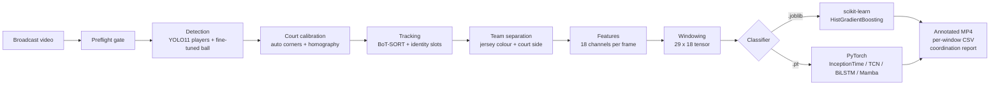
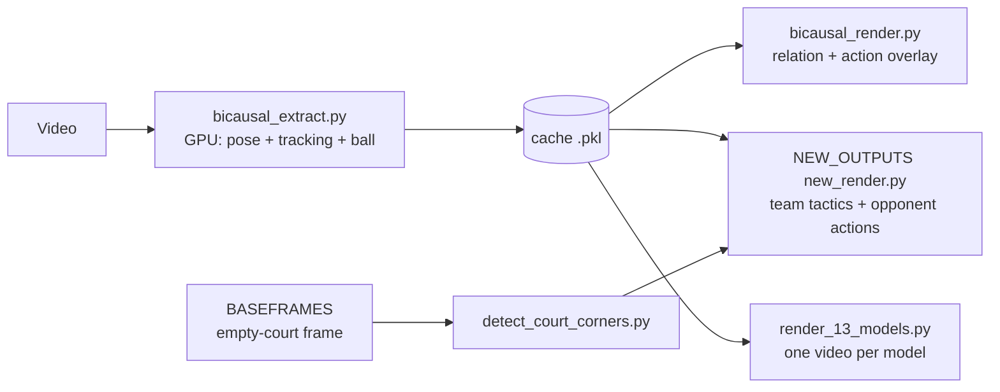
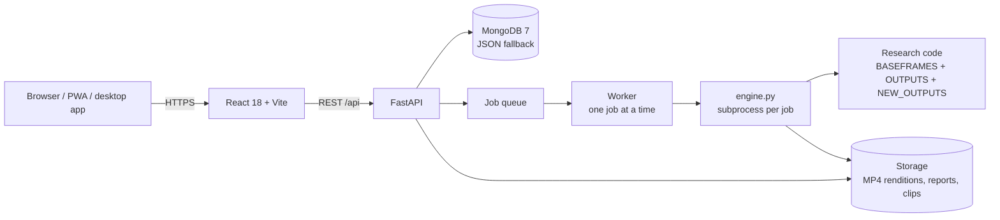

# System Architecture

This page explains how the system is built: the processing stages, the module that owns each stage, the data contracts between them, and how the web application wraps the research code. For the mathematics behind each stage, see [METHODOLOGY.md](METHODOLOGY.md).

---

## 1. High-level view

The system has three layers:

| Layer | Folder | Role |
|---|---|---|
| Research core | `fyp/` | Detection, tracking, court, teams, features, classifiers, training, tests |
| Renderers | `OUTPUTS/`, `NEW_OUTPUTS/code/`, `PAPER_OUTPUT/code/`, `BASEFRAMES/` | Two-pass (extract once, render many) annotated videos, court detection |
| Application | `webapp/` | FastAPI API, job queue, React portal, desktop app, installer, deployment |

---

## 2. Research core (`fyp/`)

| Stage | Module | Responsibility |
|---|---|---|
| Entry point | `pipeline.py` | End-to-end run: video in, annotated video + CSV + report out |
| Input checks | `preflight.py` | Fails loudly on unusable input (too few players, degenerate team colours) |
| Detection | `interfaces.py`, `detect_utils.py` | Dual detector: stock YOLO11 for players, fine-tuned YOLO for the ball |
| Court | `court.py` | Court-quad detection, homography, camera-motion compensation, in-court mask |
| Tracking | `tracking.py`, `identity.py` | BoT-SORT / ByteTrack switch, Kalman tuning, persistent player slots |
| Teams | `teams.py` | Jersey-colour k-means; each cluster labelled by its median court side |
| Features | `features.py` | 18 permutation-invariant channels per frame (centroid, spread, hull, spacing, speeds, sync, ball) |
| Pose (optional) | `pose.py` | Biomechanical features from 17-point keypoints |
| Roles | `roles.py`, `role_analysis.py` | Attacker / setter / libero / defender inference |
| Classifier interface | `interfaces.py` | `BaseTemporalClassifier`; `.joblib` and `.pt` load through `create_temporal_classifier` |
| Classical models | `ml_classifier.py` | 12-model zoo, LOVO protocol, calibration, model export |
| Deep models | `mamba_model.py`, `train_mamba.py`, `train_deep_lovo.py` | Mamba, Transformer, TCN, BiLSTM + Attention, InceptionTime |
| Data preparation | `extract_clips.py`, `prepare_training_data.py` | Labels → 1 s clips → 29-frame feature CSVs with provenance |
| Rendering | `strict_render.py`, `rebanner.py` | Display-only hardening; re-banner a video with another model without re-detecting |
| Diagnostics | `diagnose_video.py`, `diagnose_data.py`, `drift.py` | Stage-by-stage truth, dataset health, cross-video drift |
| Labelling | `annotate.py`, `label_clips.py` | Blind second-annotator pass; rule-based baseline labeller |
| Detector training | `prepare_detector_dataset.py`, `verify_detector_dataset.py`, `train_detector.py` | Leak-free ball-detector fine-tune |

### Data contracts

| Contract | Shape / format | Produced by | Consumed by |
|---|---|---|---|
| Labels | `video_file, anchor_time, tactic_class` CSV | Human annotator | `extract_clips.py` |
| Clip | 1 s MP4 at 30 fps in `dataset/<Class>/` | `extract_clips.py` | `prepare_training_data.py` |
| Feature CSV | 29 rows × 18 channels, one file per clip | `prepare_training_data.py` | `ml_classifier.py`, `train_mamba.py` |
| Provenance | `extraction_provenance.json` (detector, imgsz, tracker, team split, court flags) | `prepare_training_data.py` | Saved inside every model; checked at inference by `check_provenance` |
| Window tensor | `float32 (29, 18)` | `pipeline.py` | `BaseTemporalClassifier.classify` |
| Prediction | `ClassificationResult(label, confidence, entropy, is_anomaly, probs)` | Classifier | Banner, CSV, report |

**Provenance rule.** The flags that shape the features (`--yolo-model`, `--ball-model`, `--imgsz`, `--team-split`, `--auto-court`, `--court-coords`, `--tracker`) are stored at extraction time and compared at inference time. A mismatch aborts the run instead of producing confident wrong labels.

---

## 3. Renderers

Expensive detection runs once and is cached; rendering replays the cache, so each new visual style or model costs minutes, not hours.

| Folder | Output |
|---|---|
| `BASEFRAMES/` | Empty-court base frame per video and verified court corners + homography |
| `OUTPUTS/` | Bi-Causal (CVPR 2024) style relation / interaction video, offline ball tracking |
| `NEW_OUTPUTS/code/` | Near-team tactic graph, opponent SERVE / SPIKE / BLOCK timeline (used by the web app) |
| `FINALE_OUTPUTS/`, `ALL_13_MODELS/` | 13-model comparison videos and accuracy table |
| `v7_tactical/` | Full-match Attack/Defense annotation with HMM smoothing |

---

## 4. Web application (`webapp/`)

| Module | Responsibility |
|---|---|
| `backend/app/main.py` | REST API and static frontend hosting |
| `backend/app/worker.py` | Single worker; queue survives restarts; retention clean-up |
| `backend/app/engine.py` | Base frame → court detection → extraction → render → ffmpeg renditions (ultra / 720p / 480p / 360p) → reports |
| `backend/app/reports.py` | Team tactical report and opponent report as TXT, CSV and JSON |
| `backend/app/clips.py` | Short clips cut per detected tactic |
| `backend/app/project.py` | Documentation portal data read live from the repository |
| `backend/app/db.py` | MongoDB storage with automatic JSON-file fallback |
| `frontend/src/` | Portal, upload, progress, results, history, demos, team pages |
| `desktop/`, `installer/` | pywebview desktop window; Inno Setup Windows installer |
| `Dockerfile`, `docker-compose.yml`, `azure/` | GPU image; CPU cloud VM with MongoDB and Caddy (automatic HTTPS) |

### REST API

| Method | Path | Purpose |
|---|---|---|
| GET | `/api/health` | Liveness and capability check |
| POST | `/api/uploads` | Start a chunked upload |
| PUT | `/api/uploads/{uid}/chunks/{index}` | Upload one chunk |
| POST | `/api/analyses` | Queue an analysis for an uploaded video |
| GET | `/api/analyses` | List the caller's analyses |
| GET | `/api/analyses/{id}` | Status, progress and results of one analysis |
| POST | `/api/analyses/{id}/cancel` | Cancel a queued or running analysis |
| DELETE | `/api/analyses/{id}` | Delete an analysis and its files |
| GET | `/api/analyses/{id}/files/{name}` | Download a rendition or report |
| GET | `/api/analyses/{id}/clips/{tactic}/{name}` | Download a per-tactic clip |
| GET | `/api/analyses/{id}/court.png` | Detected court overlay |
| GET | `/api/project/metrics`, `/docs`, `/docs/{slug}`, `/figures`, `/demos`, `/info` | Documentation portal content |

Interactive API docs are served by FastAPI at `/docs` when the backend runs.

---

## 5. Key design decisions

| Decision | Reason |
|---|---|
| Two detectors (stock for players, fine-tune for ball) | The small fine-tune lost players on unseen footage (0.3 per frame) but raised ball recall from 16% to 67% |
| `imgsz 1280` | Ball recall rises from 15% at 640 px to 77% at 1280 px with the same weights |
| Team = colour cluster + median court side | Colour is stable per frame but has no team meaning; court side has meaning but is ambiguous at the net |
| Scale-invariant, permutation-invariant features | Absolute distances leak camera identity; a formation is a set, not an ordered list |
| HistGradientBoosting deployed, deep models as comparison arms | Tree models win on small tabular-like data; chosen before results were seen |
| Leave-one-video-out evaluation | The only split where the test match is truly unseen |
| Two-pass extract / render | GPU work once; any number of cheap re-renders |
| Provenance stored in every model | Catches silent train/serve flag mismatches |
